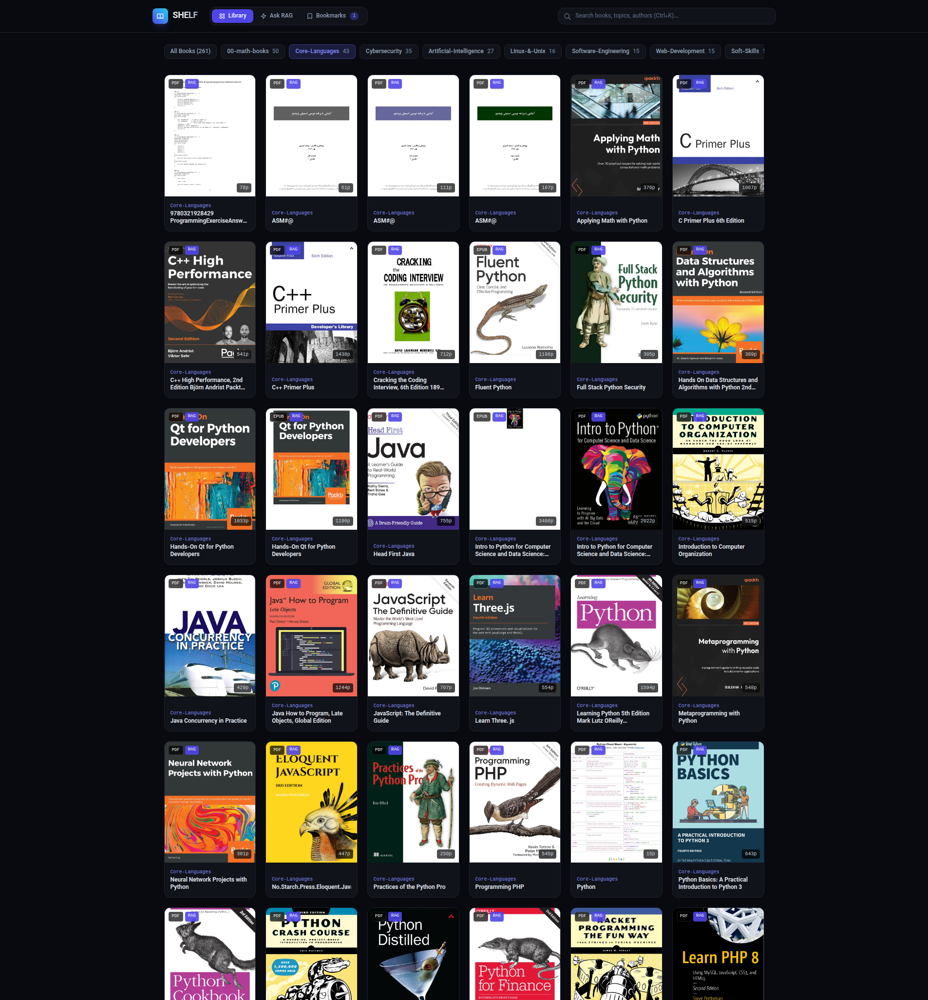
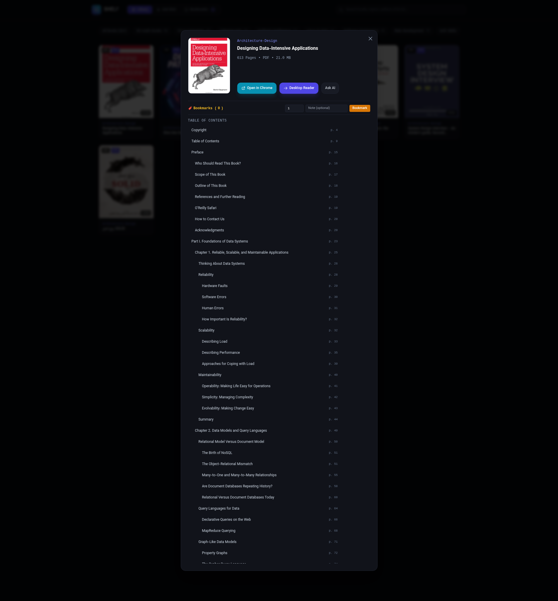

# Shelf 📚

> Intelligent Local-First Technical Library & Grounded RAG Engine.

Shelf is an offline-first technical book management system and hybrid RAG assistant designed for engineers. It indexes technical PDF/EPUB books, extracts clean covers and table of contents, and enables sub-second hybrid keyword and semantic retrieval across hundreds of thousands of pages.

## Key Features

- **Offline-First Architecture:** Runs 100% locally on Linux without Docker, external vector databases, or heavy ML frameworks.
- **Fast Local Embeddings:** Powered by FastEmbed and ONNX Runtime (`bge-small-en-v1.5`), utilizing low memory (<150 MB) and high CPU/GPU concurrency.
- **Hybrid Search (FTS5 + Dense Vectors):** Combines SQLite Full-Text Search (BM25) with dense vector cosine similarity using Reciprocal Rank Fusion (RRF).
- **Grounded Citations:** Every query provides verified book titles, chapter names, and exact page numbers.
- **Desktop Reader Integration:** Seamlessly launch books at specific pages in native Linux viewers (`Sioyek`, `Zathura`, `Okular`).
- **Dual Mode (Optional LLM):** Use AI synthesis with OpenAI-compatible endpoints or ultra-fast raw passage retrieval (<80ms) without any LLM.
- **Raycast/Linear Dark Web UI:** Minimalist web dashboard built with FastAPI, Tailwind CSS, and Alpine.js.

## Screenshots

### Library Dashboard


### Grounded RAG Search & Citations


### Book Details & Reader Launch


## Installation

```bash
# Clone the repository
git clone https://github.com/pyr0ken/shelf.git
cd shelf

# Set up virtual environment with uv
uv venv
source .venv/bin/activate
uv pip install -e .
```

## Configuration

Copy `.env.example` to `.env` and set your local preferences:

```bash
cp .env.example .env
```

```env
SHELF_BOOKS_DIR=/path/to/books
SHELF_LLM_BASE_URL=http://127.0.0.1:8000/v1
SHELF_LLM_MODEL=auto/best-fast
```

## CLI Usage

```bash
# Scan and extract book covers & metadata
shelf scan

# List books by category
shelf list --category Cybersecurity

# Instant full-text search
shelf search "compiler design"

# Build vector embeddings for RAG
shelf index-rag --all

# Ask questions with verified citations
shelf ask "How does epoll differ from select and poll in Linux?"

# Ultra-fast raw retrieval without LLM
shelf ask "Building a TCP proxy in Python" --no-llm

# Open a book at a specific page in your system reader
shelf open <book_id> --page 42

# Launch the Web Dashboard
shelf serve --host 127.0.0.1 --port 7788
```

## License

MIT
